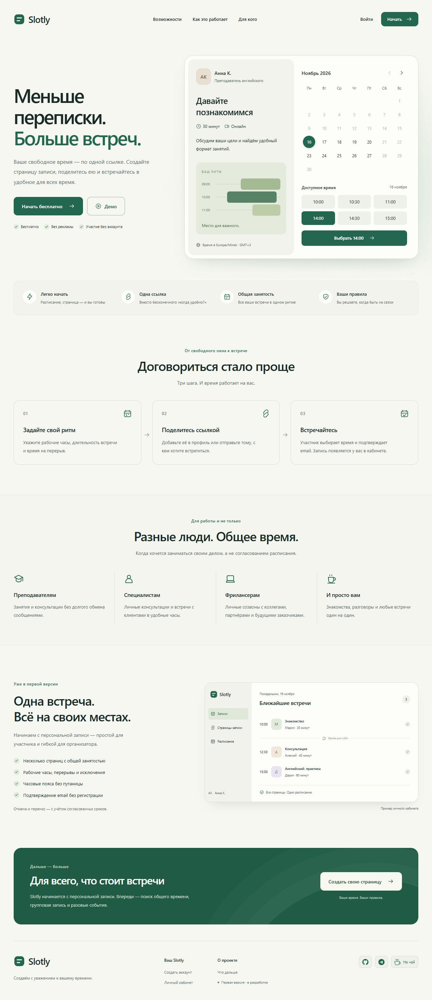

# Slotly

Встречи и запись по ссылке — с уважением к вашему времени.

Slotly задуман как бесплатный инструмент организации времени. Первый MVP решает
персональную запись: организатор задаёт рабочие часы, публикует страницу и
делится ссылкой, участник выбирает время и подтверждает email без регистрации.

**Статус:** рабочий локальный MVP. Внешняя отправка писем и инфраструктура
публичного пилота ещё не подключены. Сейчас все письма доступны в локальной почте.



## Что работает

- Аккаунт организатора: регистрация, подтверждение email, вход и восстановление.
- Общее расписание, исключения по датам, часовые пояса и переходы DST.
- Несколько страниц записи с общей занятостью, настройками времени и публикацией.
- Свободные слоты и подтверждение email участника одноразовым кодом.
- Защита от двойного бронирования PostgreSQL, сохранение условий и истории.
- Личная ссылка для отмены и переноса, отмена организатором с пояснением.
- Уведомления обоим участникам через транзакционную очередь с повторной доставкой.
- Кабинет с обзором, предстоящими, прошедшими и отменёнными встречами и пагинацией.

Поиск общего времени, групповая запись и разовые события остаются частью
долгосрочной концепции. Команды, платежи и внешние календарные интеграции пока
не входят в текущую версию.

## Локальный запуск

Нужны **Node.js 24.x** и **npm 11.x**. Для локального PostgreSQL используется
`embedded-postgres`; Docker не требуется. Данные сохраняются в `.local/postgres`.
Порты по умолчанию: приложение **3000**, PostgreSQL **54329**, почта **8025**.

Первый терминал, из корня проекта:

```sh
npm ci
npm run setup
npm run db:local
```

Второй терминал:

```sh
npm run db:migrate
npm run db:roles
npm run db:check
npm run dev
```

Третий терминал:

```sh
npm run mail:local
```

Откройте [Slotly](http://localhost:3000) и [локальную почту](http://localhost:8025).
`dev` запускает веб-сервер и обработчик уведомлений вместе. `Ctrl+C` останавливает
процессы в соответствующем терминале; данные базы сохраняются.

`setup` создаёт `.env.local` со случайными секретами и сохраняет существующие
настройки при повторном запуске. Используйте адрес `APP_URL` (по умолчанию
`http://localhost:3000`): проверка Origin защищает операции записи.

Собственный PostgreSQL, TLS, миграции и детали Windows — в
[инструкции разработчика](docs/development.md).

## Проверки

```sh
npm run lint
npm run typecheck
npm test -- --maxWorkers=2
npm run test:integration -- --maxWorkers=1
npm run build
```

Интеграции используют настоящий локальный PostgreSQL: создают случайные базы
`slotly_test_*`, применяют миграции и удаляют только эти базы. Рабочую базу не
очищают. Административному тестовому подключению нужны права создания баз и
изолированных тестовых ролей; бизнес-операции проверяются с ограниченным логином.

GitHub Actions запускает те же проверки с отдельным PostgreSQL-сервисом.
`npm run repo:check` проверяет файлы Git на локальные артефакты и известные
форматы секретов. Проверка не заменяет просмотр изменений перед публикацией.

Для запуска готовой сборки: `npm run build`, затем `npm run start` при работающих
PostgreSQL и локальной почте.

`npm run db:backup` создаёт зашифрованную копию и проверяет её восстановление в
отдельную базу; `npm run ops:check` проверяет БД, очередь и последний архив.
Подготовка утилит и ключа, порядок восстановления — в [инструкции](docs/operations.md).

После миграций `npm run db:roles` разделяет локальные подключения приложения,
миграций и администратора. Затем перезапустите приложение.
[Права PostgreSQL и CSP](docs/security.md).

Готов настраиваемый SMTP-транспорт, локально он выключен. `npm run mail:check`
проверяет выбранный транспорт без отправки письма; [настройка и ограничения](docs/mail.md).

## Стек и устройство

Next.js · React · TypeScript · Tailwind CSS · PostgreSQL · Drizzle · Better Auth.
Приложение — модульный монолит. Better Auth отвечает за аккаунты организаторов;
гостевое подтверждение email не создаёт аккаунт.

```text
src/app/             маршруты, страницы и HTTP-границы
src/modules/         предметные операции и их интерфейсы
src/server/          конфигурация, БД, почта и защита запросов
src/components/      общие UI-компоненты и лендинг
src/i18n/messages/ru/ русские тексты, основа будущей локализации
src/shared/          общие функции и ошибки
scripts/             локальные сервисы, проверки и обработчик уведомлений
drizzle/             SQL-миграции и метаданные
tests/               интеграции PostgreSQL и фикстуры
```

| Область | Документация |
| --- | --- |
| Окружение и миграции | [Разработка](docs/development.md) |
| Хранение и целостность | [База данных](docs/database.md) |
| Аккаунты | [Авторизация](docs/identity.md) |
| Расписание и страницы | [Планирование](docs/planning.md) |
| Время и слоты | [Доступность](docs/availability.md) |
| Одноразовый код и запись | [Гостевое бронирование](docs/guest-booking.md) |
| Отмена и перенос | [Управление встречей](docs/booking-management.md) |
| Очередь и доставка | [Уведомления](docs/notifications.md) |
| Обзор и списки | [Кабинет](docs/dashboard.md) |
| Копии, восстановление и диагностика | [Эксплуатация](docs/operations.md) |
| Роли PostgreSQL и защитные заголовки | [Безопасность](docs/security.md) |
| Локальная почта и SMTP | [Почтовый транспорт](docs/mail.md) |
| IP прокси и общие лимиты писем | [Подготовка защиты пилота](docs/abuse-protection.md) |

Локальные настройки, база, письма, скриншоты QA и сборки исключены из Git.
О подготовке изменений — в [CONTRIBUTING](CONTRIBUTING.md), о сообщениях
об уязвимостях — в [SECURITY](SECURITY.md).

Отдельная лицензия на собственный код Slotly пока не выбрана. Уведомления и
лицензии сторонних материалов сохранены в [THIRD_PARTY_NOTICES](THIRD_PARTY_NOTICES.md).
